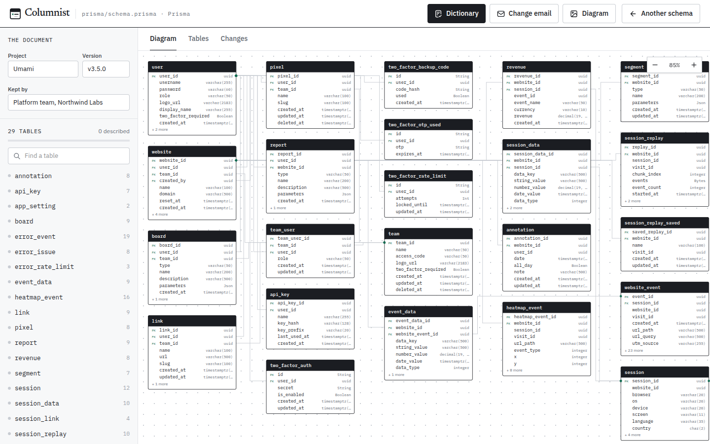
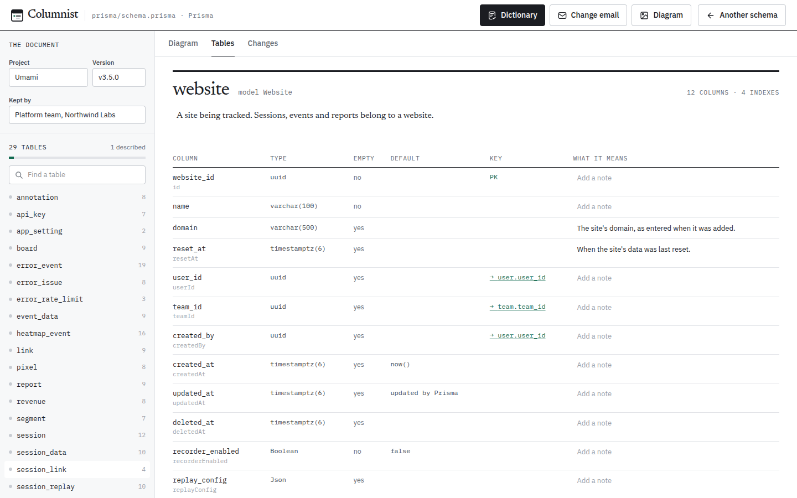
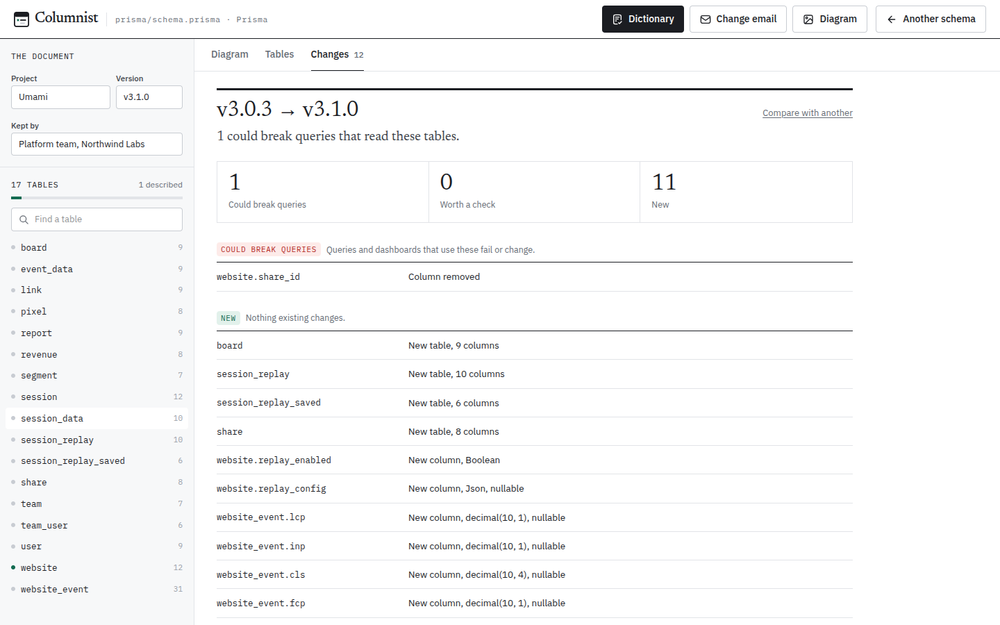
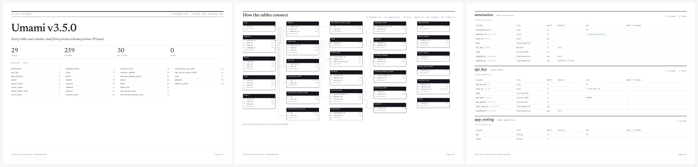
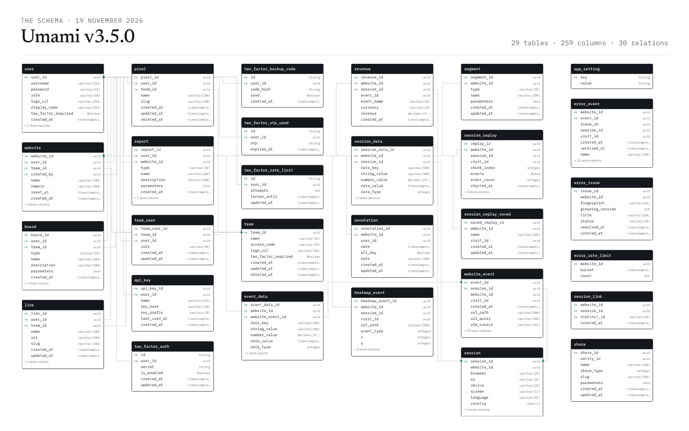
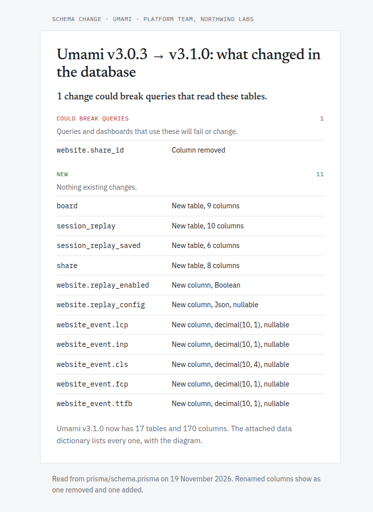

# Columnist

**The data dictionary that writes itself from your schema.** Drop a `schema.prisma` or a `pg_dump --schema-only`
file. Columnist writes three things from it:

- a data dictionary (PDF) with the diagram and every table and column
- a schema change email for the people who query the database
- the diagram as an image (PNG) for a README or a pull request

Built with [Hyper Elements](https://github.com/hyper-elements/hyper-elements) for the Hyper Elements Template Challenge.



## Why this exists

The schema already knows every table, type, key and default. The people who read the database (analysts, data
engineers, support, auditors) can't read it, and a dictionary written by hand goes stale with the next migration.

> "Who is responsible for maintaining a data dictionary?… nobody. Nobody ever maintains the data dictionary."
> ([r/dataengineering, Feb 2022](https://old.reddit.com/r/dataengineering/comments/sq8mio/))

> "If I asked someone where their data dictionary is and they sent me a folder of YAML I'd be throwing hands"
> (same thread)

Migrations also break things downstream. A real example: Umami v3.1.0 (16 April 2026) removed
`website.share_id` and moved sharing into a new `share` table. Any report that joined on that column stopped
working. Columnist finds that by comparing the two versions of `prisma/schema.prisma`.

## How it works

| Step | What happens |
|---|---|
| **Read** | Upload the file, paste it, or paste a GitHub file link (read from `raw.githubusercontent.com`). Four real samples are one click away. |
| **Describe** | Browse the diagram, open any table, and write what it holds and what its columns mean. Notes are kept in your browser per project. Prisma `///` comments and SQL `COMMENT ON` come in on their own. |
| **Compare** | Load the version from the last release. Every difference is sorted by what it does to a query: *could break it* (removed, retyped), *worth a check* (nullability, keys, defaults), or *new*. |
| **Send** | Preview and download the dictionary, the change email and the diagram. |





The dictionary (A4 landscape): a cover with the contents and page numbers, the diagram (key columns only), then every table.



| Diagram (PNG) | Change email |
|---|---|
|  |  |

The landing page (7 sections with an FAQ): [media/landing.png](media/landing.png). The dashboard on a phone:
[media/mobile.png](media/mobile.png).

## What it reads

- **Prisma:** `model` and `view` blocks, `@map`/`@@map` names (the dictionary shows the database name, with the
  name in the code beside it), native types (`@db.VarChar(255)` → `varchar(255)`), defaults, `@id`, `@@id`,
  `@unique`, `@@unique`, `@@index`, relations (`@relation(fields, references)`), enums and `///` doc comments.
  Works for any Prisma provider.
- **PostgreSQL (`pg_dump --schema-only`):** `CREATE TABLE`, primary, unique and foreign keys (inline or added with
  `ALTER TABLE`), identity and `nextval` defaults, indexes, `CREATE TYPE … AS ENUM`, and `COMMENT ON`. Statements
  are split with quotes and `$$` function bodies respected. Partitions are listed under their parent table, which
  takes their foreign keys.

Known limits: renamed columns show as one removed and one added. Raw SQL from other databases is read with
PostgreSQL's syntax. The diagram draws the 40 most connected tables.

## How Hyper Elements is used

The three outputs are **Hyper Elements templates** in `templates/`. The app renders them in a route handler
(`src/app/api/render/route.ts`), and the CLI renders the same files.

- **Typed fields with rules** (`templates/_shared/doc.tsx`): a list of 1 to 150 tables, each a list of 1 to 150
  columns. A key is one of `pk`, `fk` or `pk fk`, a reference must look like `table.column`, and a change is
  `breaking`, `check` or `added`. A value outside the rules stops the render with the field and the reason (the app
  shows it; the API answers 422).
- **`<Document>` + `renderPdf()`** for the dictionary, A4 landscape. Tables are packed onto pages by their estimated
  height. A table that fits a fresh page is never split, and a longer one continues. The contents page numbers come
  from the same packing. `Table`, `PageBreak`, `PageFooter`, `PageNumber`.
- **One diagram, two outputs.** `Diagram` lays the tables out in columns, breadth-first from the most connected
  table, and picks the column count that draws largest in the space. Boxes and connectors are `Rect`, `Path` and
  `Circle` in an `Svg`, inside a `Layer`. Each table's labels are a `Layer` child padded to its box's corner (an
  `Svg` holds no text). The same component is vector in the PDF and pixels in the PNG.
- **`<Canvas>` + `renderImage()`** for the 1600 × 1000 diagram, with `image/overflow`, `image/glyph` and
  `image/fit` required. Names are cut to fit their box before they could spill.
- **`<Email>`** with a `defineTheme()` theme, checked by lint (`lang`, `contrast`, `link-text`) and the email
  client checks, with preview text required.
- **Values files + CLI:** `npm run docs` turns `docs/umami.json` into values files with `hyper-elements design
  new`, then renders the PDF, the email and the PNG with `hyper-elements render`.

## Run it

Needs Node 22.6+.

```bash
npm install
npm run dev            # http://localhost:3000 (landing) and /studio (the dashboard)
```

```bash
npm test               # parsers on the real Umami and Pagila files, diff, layout, paging (8 tests)
npm run check          # check the three templates with their example
npm run docs           # docs/umami.json → out/docs/ (dictionary PDF, change email, diagram PNG)
npm run sample         # rebuild the sample from public/samples/
npm run preview:email  # the email as each email client draws it
npm run build && npm start
```

## Project layout

```
templates/_shared/schema.ts   Prisma and Postgres parsers, the diff, the diagram layout, page packing (no imports)
templates/_shared/values.ts   from a parsed schema and notes to the values the templates take
templates/_shared/doc.tsx     fields, look, and the Diagram component
templates/_shared/example.ts  the sample: Umami v3.5.0 compared with v3.4.1 (generated by scripts/sample.ts)
templates/dictionary.tsx      <Document>: the data dictionary
templates/changes.tsx         <Email>: the schema change notice
templates/diagram.tsx         <Canvas>: the diagram
src/lib/sources.ts            file, pasted text, GitHub link, bundled samples
src/components/Studio.tsx     the dashboard: start, table list, diagram, table, changes, output drawer
src/app/page.tsx              the landing page
public/samples/               real schema files and their licences
tests/                        schema tests
```

## Sample data

All schemas are real public files, unchanged:

- `umami-v3.0.3`, `v3.1.0`, `v3.4.1` and `v3.5.0.prisma`: Umami's `prisma/schema.prisma` at those tags
  ([github.com/umami-software/umami](https://github.com/umami-software/umami), MIT, licence in
  `public/samples/LICENSE-umami.txt`). v3.5.0 was released on 12 November 2026.
- `pagila-schema.sql`: [Pagila](https://github.com/devrimgunduz/pagila) (PostgreSQL License, licence in
  `public/samples/LICENSE-pagila.txt`).

"Northwind Labs" and the table notes in the sample are ours, written from the schema's own names and defaults.
Columnist is not affiliated with Umami, Prisma or PostgreSQL.

## License

MIT for the code. Fonts: Newsreader and IBM Plex (Sans, Mono), SIL Open Font License 1.1 (`fonts/OFL-*.txt`).
